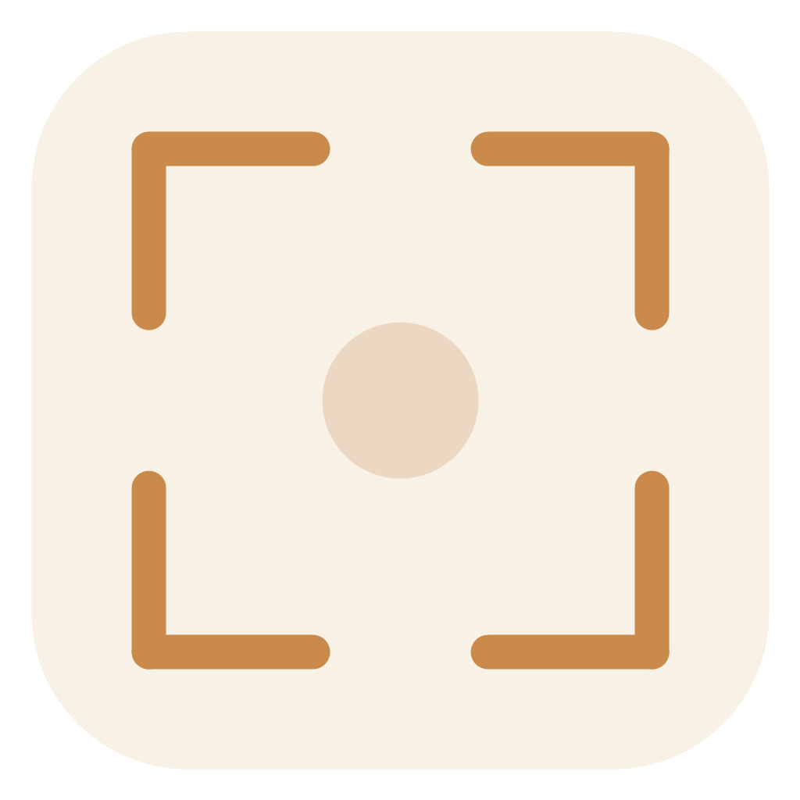
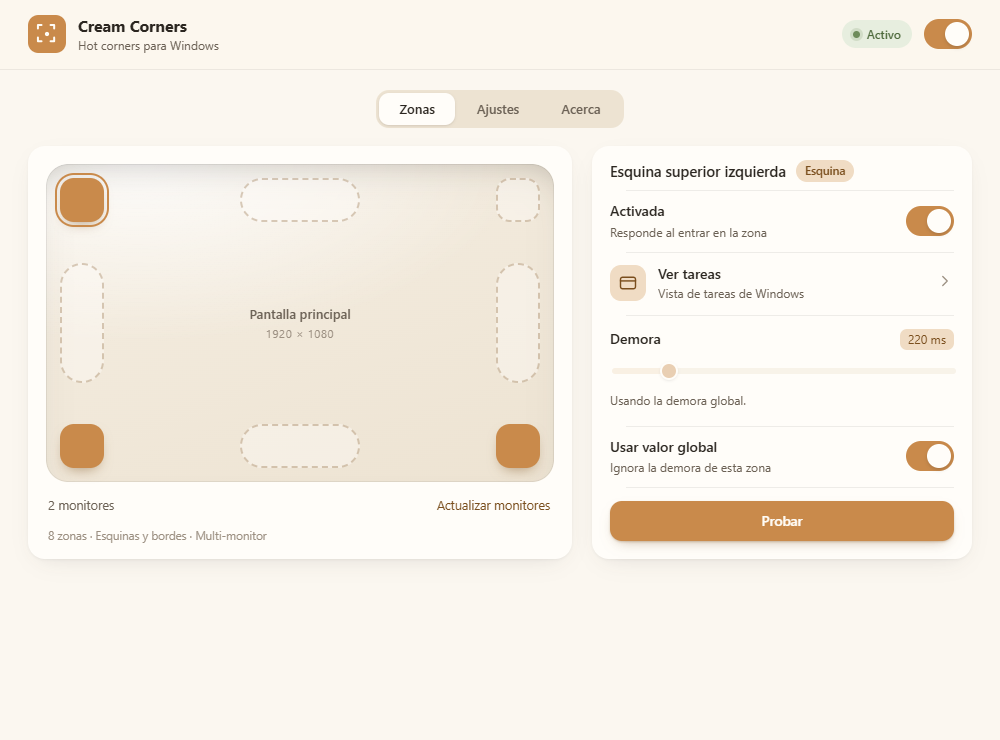
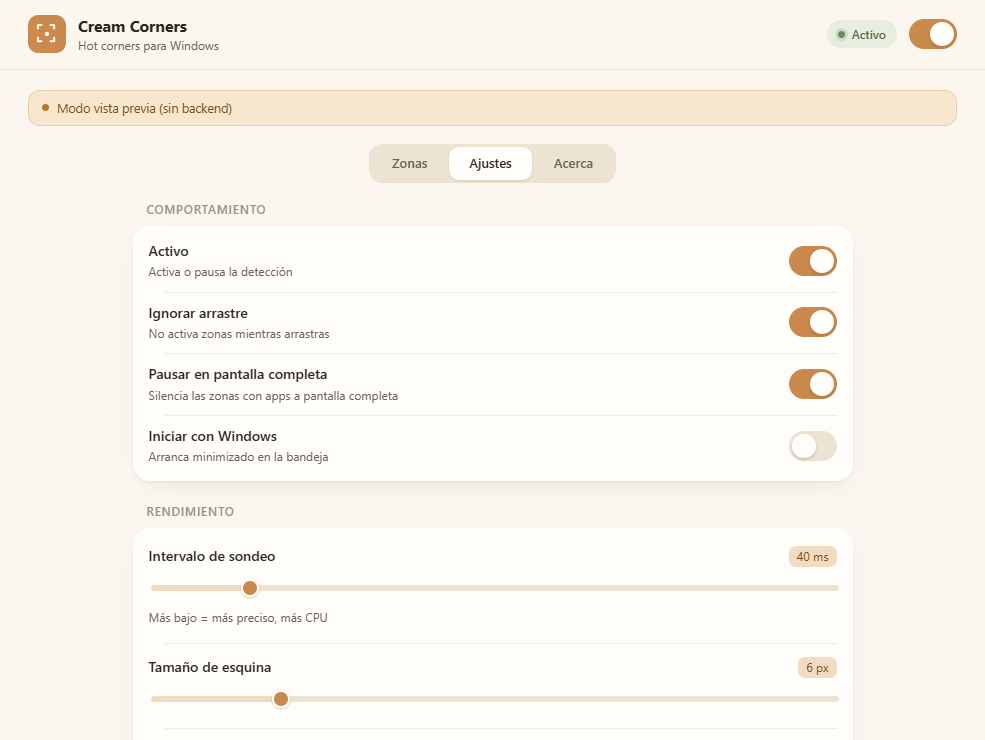

# Cream Corners — Hot Corners para Windows 10 y 11

Hot corners para Windows 10 y 11: al llevar el cursor a una esquina o a un borde de la pantalla se ejecuta una acción (ver tareas, mostrar escritorio, bloquear el equipo, abrir una URL, lanzar un programa). Windows no trae hot corners de mouse configurables, así que esta app los añade, gratis y con licencia MIT. Rust + Tauri 2, UI TypeScript sin framework y cada zona configurable hasta su propia demora.

Sitio web: https://canopus44.github.io/cream-corners/  
Creado y mantenido por [Canopus44](https://github.com/Canopus44).

[English](README.md) · [Español](README.es.md)

[](https://www.rust-lang.org/)
[](https://tauri.app/)
[](LICENSE)
[](docs/es/instalacion.md#requisitos)
[](https://github.com/Canopus44)

Vive en la bandeja del sistema. Al cerrar la ventana no se cierra la app: se oculta y se reabre con clic izquierdo en el icono, con doble clic o con **Cambiar comandos** en el menú.

## Capturas

Ventana principal, con las ocho zonas y sus acciones:



Ajustes generales: activación, demora, cooldown, tamaños, multi-monitor e inicio con Windows:



## Funciones

| Función | Detalle |
|---|---|
| 8 zonas | 4 esquinas + 4 bordes, cada una con activación, acción y demora propias |
| 17 presets | Atajos y utilidades de Windows listos para asignar |
| Comandos externos | Programa + argumentos, sin shell intermedio |
| URLs | Esquemas `http`, `https`, `ms-`, `shell:` |
| Demora de activación | Global 0–3000 ms (220 por defecto) y anulación por zona |
| Cooldown | 0–10000 ms (800 por defecto) para evitar re-disparos |
| Tamaño de zona | Esquina 1–64 px (6 por defecto), borde 1–32 px (4 por defecto) |
| Sondeo del cursor | 15–500 ms (40 por defecto) |
| Ignorar arrastres | No dispara mientras hay un botón del mouse presionado |
| Pausa en pantalla completa | Detecta apps fullscreen y no interfiere con el escritorio ni la barra de tareas |
| Multi-monitor | Alcance en todos los monitores o sólo el principal |
| Inicio con Windows | Entrada `CreamCorners` en `HKCU\...\CurrentVersion\Run` |
| Instancia única | Mutex `Local\CreamCornersSingleton`; el segundo lanzamiento trae al frente la ventana existente |
| Config versionada | Autoguardado, backup y recuperación de archivos corruptos |
| Bandeja | Check "Activo", "Cambiar comandos", "Salir" |

## Cómo se compara

| Opción | Zonas | Stack | Licencia |
|---|---|---|---|
| Windows integrado | Sin hot corners de mouse configurables; Snap Layouts y los gestos de esquina táctiles no son lo mismo | — | — |
| HotCornersWin | Sólo esquinas | C#/.NET, sólo Windows | MIT |
| Cream Corners | 4 esquinas + 4 bordes, con acción y demora por zona | Rust + Tauri 2, sólo Windows | MIT |

## Inicio rápido

Para instalar la versión publicada, salta a [Instalación](#instalación). Para trabajar sobre el código, requisitos: Windows 10/11 x64, Rust estable ≥ 1.77, Node.js ≥ 20 y Visual Studio Build Tools con el workload "Desarrollo para el escritorio con C++".

```bash
npm install
npm run tauri dev     # desarrollo
npm run tauri build   # instaladores en src-tauri/target/release/bundle
```

Detalle completo en [docs/es/compilar.md](docs/es/compilar.md).

## Instalación

Descarga el instalador desde el [último release](https://github.com/Canopus44/cream-corners/releases/latest). El archivo recomendado es `Cream Corners_0.1.0_x64-setup.exe` (NSIS): instala para todos los usuarios en Archivos de programa, pide confirmación de UAC y ofrece la interfaz de instalación en inglés y español. El MSI `Cream Corners_0.1.0_x64_en-US.msi` es la alternativa para despliegue administrado. Ambos están adjuntos al release `v0.1.0`, junto con las sumas SHA-256 para verificar la descarga.

Si aparece SmartScreen, pulsa "Más información" y luego "Ejecutar de todas formas", porque los instaladores no están firmados. Al terminar, la app queda en la bandeja del sistema. Requiere Windows 10/11 x64 y WebView2 Runtime (incluido en Windows 11 y en la mayoría de Windows 10). La configuración vive en `%APPDATA%\CreamCorners\settings.json` y la desinstalación no la borra. Guía completa, requisitos, SmartScreen, checksums y problemas frecuentes en [docs/es/instalacion.md](docs/es/instalacion.md).

## Estructura

```
cream-corners/
├─ src-tauri/src/   # main, lib, settings, win32 (FFI), actions, engine, tray
├─ src/             # main.ts (UI), style.css, types.ts
├─ index.html
└─ docs/
```

## Documentación

La documentación está en dos idiomas: inglés como principal (`README.md`, `docs/*.md`) y español (`README.es.md`, `docs/es/*.md`). La interfaz de la app sigue en español. El sitio publicado está en https://canopus44.github.io/cream-corners/.

- [Instalación](docs/es/instalacion.md) — instalar, primer uso, desinstalar y problemas frecuentes
- [Arquitectura](docs/es/arquitectura.md) — módulos, concurrencia, flujo del motor
- [Configuración](docs/es/configuracion.md) — archivo JSON, campos, backup y saneado
- [Acciones](docs/es/acciones.md) — presets, comandos y URLs
- [Compilar](docs/es/compilar.md) — requisitos, desarrollo y empaquetado
- [Solución de problemas](docs/es/solucion-de-problemas.md) — síntomas frecuentes
- [Contribuir](CONTRIBUTING.md) — flujo de trabajo, estilo y verificación (en inglés)

## Estado

- Frontend: `npm run build` verificado (tsc + vite).
- Backend Rust: `cargo check` y `npm run tauri build` verificados; instaladores NSIS y MSI generados.
- Prueba end-to-end real: el exe release renderiza la UI y abre "Vista de tareas" al dejar el cursor en la esquina superior izquierda.

Nota: en la máquina de desarrollo, ejecutar el exe desde una ruta bajo Documentos hace que el sistema deniegue la escritura de la configuración (os error 5). Instalado en Archivos de programa funciona con normalidad; ver [solución de problemas](docs/es/solucion-de-problemas.md).

## Preguntas frecuentes

### ¿Windows trae esquinas activas de serie?

No. Windows 10 y 11 no tienen hot corners de mouse configurables: Snap Layouts y los gestos de esquina táctiles son funciones distintas, no acciones de esquina asignables. Eso es justo lo que añade esta app.

### ¿Es gratis?

Sí. Licencia MIT, sin cuenta y sin telemetría.

### ¿Funciona en Windows 10 y 11?

Sí, en ambos, x64.

### ¿Soporta varios monitores?

Sí: todos los monitores o sólo el principal, desde los ajustes.

### ¿Se activa en juegos o con vídeo a pantalla completa?

La detección se pausa mientras hay una app fullscreen en primer plano, y no dispara nada mientras hay un botón del mouse presionado.

### ¿Cómo se desinstala?

Configuración > Aplicaciones > Cream Corners (o Programas y características en el Panel de control) y, opcionalmente, borrar `%APPDATA%\CreamCorners`.

## Limitaciones

- Sólo Windows (x64). La UI está en español y no hay actualizador automático.
- El motor sondea el cursor en lugar de usar un hook de mouse, así que la latencia es aproximadamente el intervalo de sondeo.
- Las teclas se envían con `keybd_event` (entrada sintética): algunas apps o ventanas elevadas pueden ignorarlas. Sin firma de código, SmartScreen puede advertir al instalar.
- No es per-monitor DPI aware: con escalas distintas por monitor las zonas pueden quedar desplazadas.

## Contribuir

El flujo, los estándares de código y las comprobaciones previas a un PR están en [CONTRIBUTING.md](CONTRIBUTING.md) (en inglés). Los cambios de documentación deben mantener sincronizadas las dos versiones, inglesa y española.

## Licencia y autor

MIT, año 2026, © [Canopus44](https://github.com/Canopus44) (ver `LICENSE`).

### Agradecimientos

Inspirada en [HotCornersWin](https://github.com/flexits/HotCornersWin) de flexits y en la idea de hot corners de macOS, GNOME y KDE. Cream Corners es una reescritura independiente en Rust que añade bordes, demora y cooldown por zona, pausa en pantalla completa, multi-monitor y configuración versionada.
