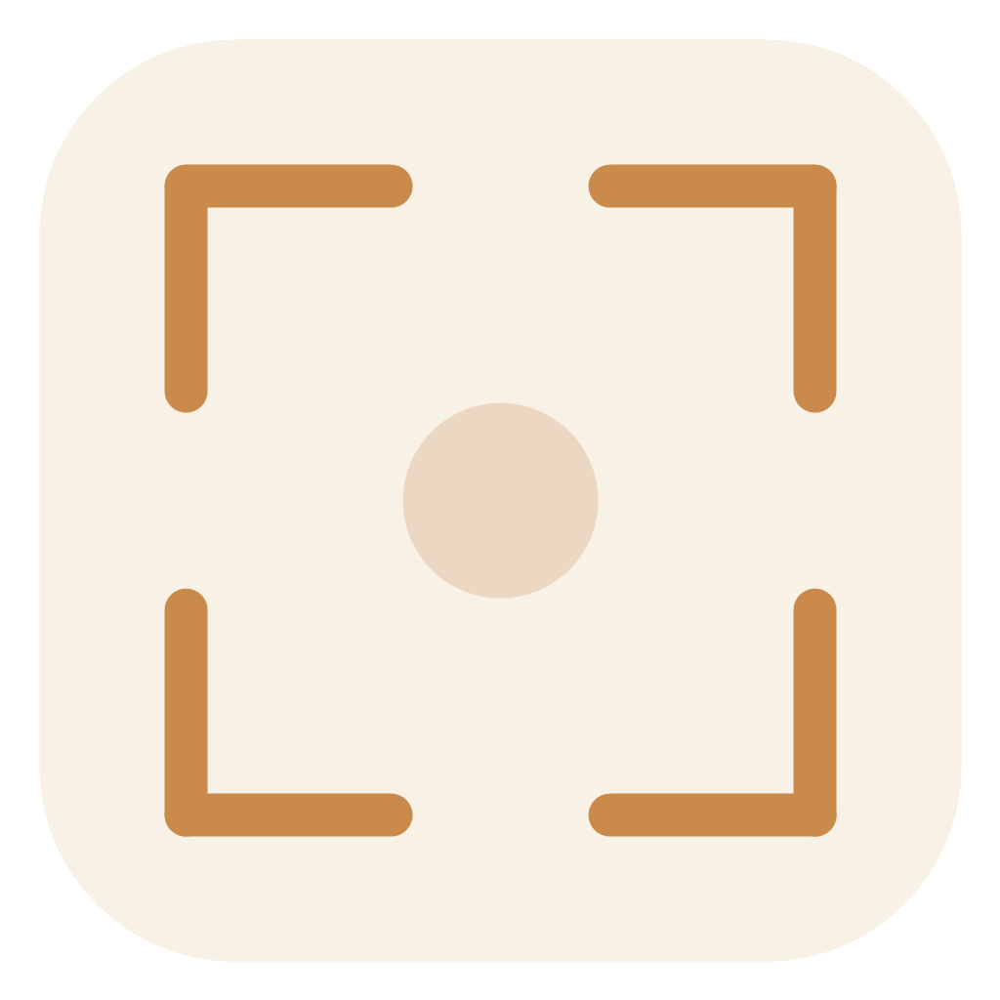
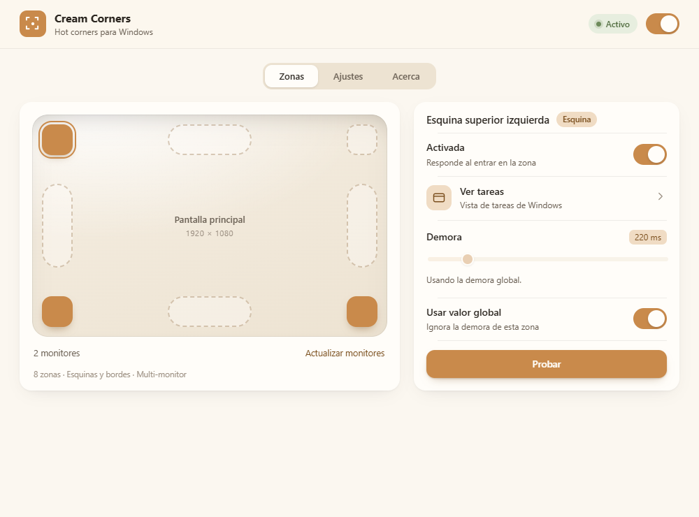
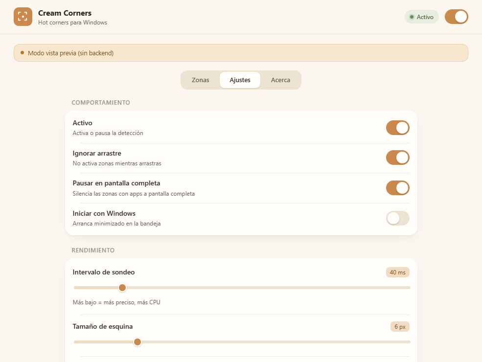
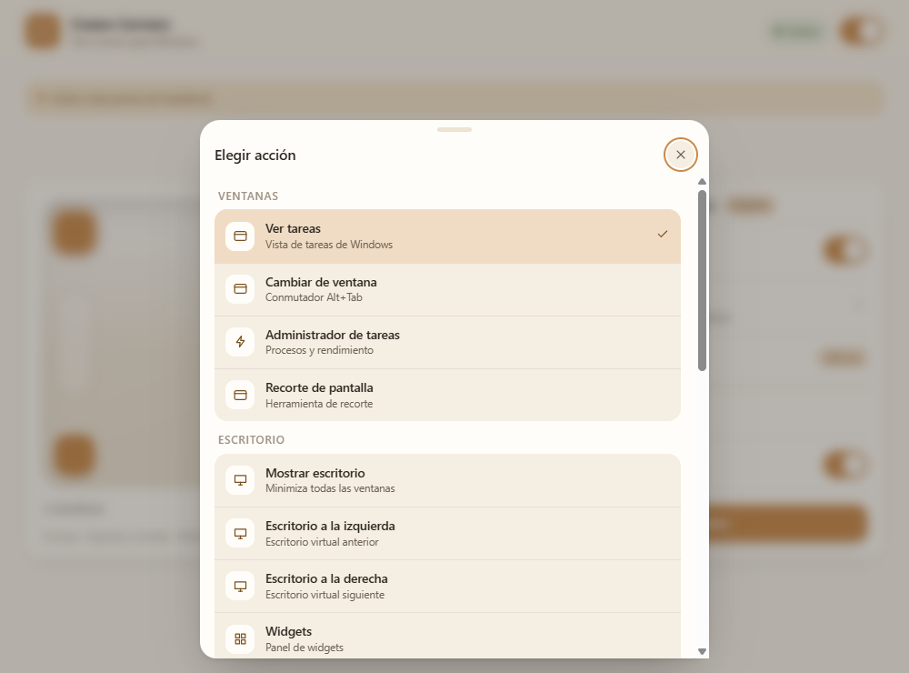
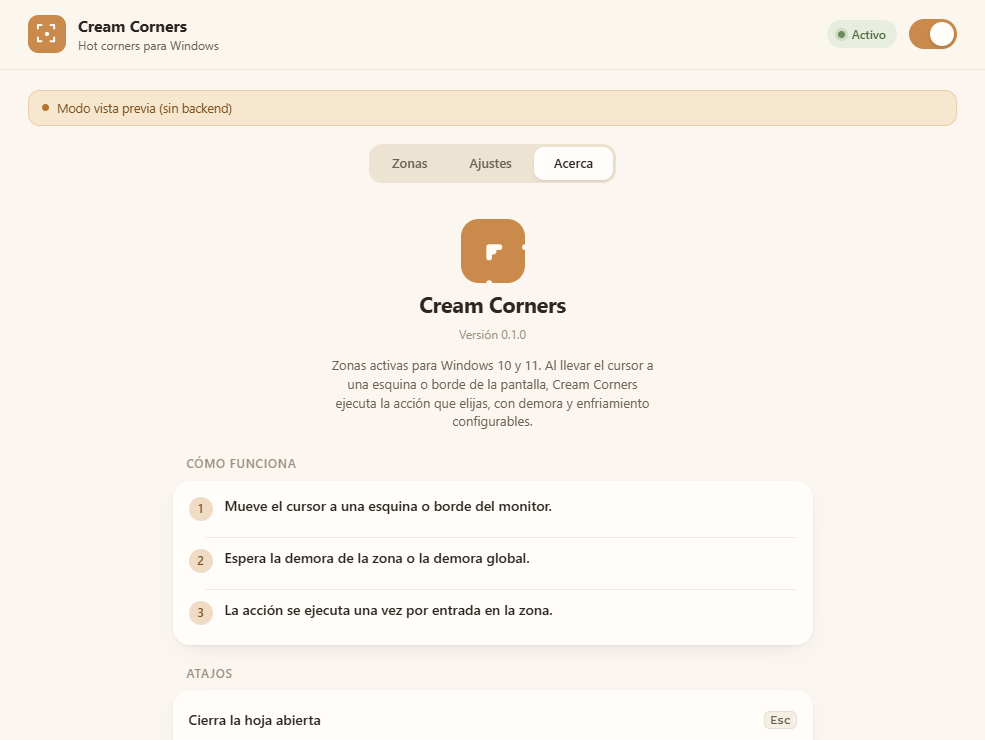

# Cream Corners

Hot corners for Windows 10 and 11: park the cursor in a screen corner or on a screen edge and an action fires — Task View, show desktop, lock the PC, open a URL, launch a program. Written in Rust with Tauri 2, a framework-free TypeScript UI, and an iOS-flavoured cream design. It lives in the tray, stays out of the way while you drag or play fullscreen, and keeps every zone configurable down to its own dwell time.

[](https://www.rust-lang.org/)
[](https://tauri.app/)
[](LICENSE)
[](#limitations)

[English](README.md) · [Español](README.es.md)

## Screenshots



The zone editor: eight zones, each with its own switch, action and dwell override.



Global tuning: dwell, cooldown, zone size, polling interval, drag and fullscreen behaviour.



Action picker: 17 presets, external commands and URLs.



About panel with version, config location and attribution.

## Features

| Feature | Detail |
|---|---|
| 8 zones | 4 corners + 4 edges, each with its own enabled flag, action and dwell override |
| 17 presets | Ready-made Windows shortcuts and utilities |
| External commands | Program plus argument list, no shell in between |
| URLs | `http`, `https`, `ms-` and `shell:` schemes |
| Dwell | Global 0–3000 ms (220 default), overridable per zone |
| Cooldown | 0–10000 ms (800 default) to stop re-triggering |
| Zone size | Corner 1–64 px (6 default), edge 1–32 px (4 default) |
| Cursor polling | 15–500 ms (40 default) |
| Drag suppression | Never fires while a mouse button is held |
| Fullscreen pause | Detection pauses for fullscreen apps; shell windows excluded |
| Multi-monitor | All monitors or primary only |
| Start with Windows | Optional `CreamCorners` value under `HKCU\...\Run` |
| Single instance | A second launch brings the existing window forward |
| Config safety | Autosave, atomic writes, backup and corrupt-file quarantine |
| Tray | Active toggle, "Change commands", "Exit" |

## Quick start

```bash
npm install
npm run tauri dev     # dev window with the Rust backend
npm run tauri build   # installers under src-tauri/target/release/bundle
```

## Install

Grab the latest installer from [Releases](https://github.com/Canopus44/cream-corners/releases/latest): `Cream Corners_0.1.0_x64-setup.exe` (NSIS, recommended) or `Cream Corners_0.1.0_x64_en-US.msi`. Both are per-machine, install under `Program Files` and ask for UAC. The installers are unsigned, so SmartScreen shows "More info" then "Run anyway". Requires Windows 10/11 x64 and the WebView2 Runtime (bundled with Windows 11 and most Windows 10). Full walkthrough, first run, uninstall and SmartScreen notes: [docs/installation.md](docs/installation.md).

## How it works

- A dedicated engine thread polls the cursor every `pollIntervalMs`, hit-tests the active zones, and accumulates the effective dwell for the zone under the pointer.
- When dwell and cooldown are satisfied the action runs on a fresh thread, so presets, programs and URLs never stall the poll loop.
- The web UI talks to the backend over eight IPC commands (`get_settings`, `save_settings`, `set_enabled`, `run_action`, `get_monitors`, `get_status`, `reset_settings`, `open_config_dir`) and reacts to `status-changed` and `action-error` events.
- Closing the window hides it; the tray icon, a left click, a double click or **Change commands** brings it back. A second process exits and signals the running one through the named event `Local\CreamCornersShow`.
- Settings persist to `%APPDATA%\CreamCorners\settings.json` with atomic writes, a 400 ms autosave debounce, `settings.bak.json` and `settings.corrupt-<epoch>.json`.

## Configuration

Path: `%APPDATA%\CreamCorners\settings.json` (falls back to `%LOCALAPPDATA%\CreamCorners\`). Defaults: dwell 220 ms, cooldown 800 ms, corner 6 px, edge 4 px, poll 40 ms, all monitors, fullscreen pause on, drag suppression on. Out of the box `topLeft` opens Task View, `bottomLeft` shows the desktop and `bottomRight` locks the PC with a 400 ms dwell; every other zone is disabled. Field-by-field reference: [docs/configuration.md](docs/configuration.md).

## Documentation

| Page | English | Español |
|---|---|---|
| Architecture | [docs/architecture.md](docs/architecture.md) | [docs/es/arquitectura.md](docs/es/arquitectura.md) |
| Configuration | [docs/configuration.md](docs/configuration.md) | [docs/es/configuracion.md](docs/es/configuracion.md) |
| Actions | [docs/actions.md](docs/actions.md) | [docs/es/acciones.md](docs/es/acciones.md) |
| Building | [docs/building.md](docs/building.md) | [docs/es/compilar.md](docs/es/compilar.md) |
| Installation | [docs/installation.md](docs/installation.md) | [docs/es/instalacion.md](docs/es/instalacion.md) |
| Troubleshooting | [docs/troubleshooting.md](docs/troubleshooting.md) | [docs/es/solucion-de-problemas.md](docs/es/solucion-de-problemas.md) |

## Status

- `cargo check`, `npm run build` and `npm run tauri build` verified; NSIS and MSI installers generated.
- The release build renders the UI and the top-left corner opens Task View.
- Development-machine quirk: running the executable from under Documents made config writes fail with OS error 5; the installed copy works normally.
- Not tested across the full range of hardware, multi-monitor arrangements or Windows builds.

## Limitations

- Windows x64 only; no ARM64 or other platforms.
- Cursor polling means latency is roughly the polling interval.
- Presets use `keybd_event`; elevated windows may ignore injected keys (UIPI).
- Not per-monitor DPI aware, so mixed-scaling setups can offset zone edges.
- No code signing, no auto-update, and the UI is Spanish-only.

## Contributing

See [CONTRIBUTING.md](CONTRIBUTING.md). Bug reports and pull requests are welcome.

## License and attribution

MIT, 2026, "Cream Corners contributors" — see [LICENSE](LICENSE).

Inspired by [HotCornersWin](https://github.com/flexits/HotCornersWin) by flexits (C#/.NET) and by hot corners in macOS, GNOME and KDE. This is a Rust rewrite that adds edges, per-zone dwell and cooldown, fullscreen pause, multi-monitor scope and versioned configuration.
