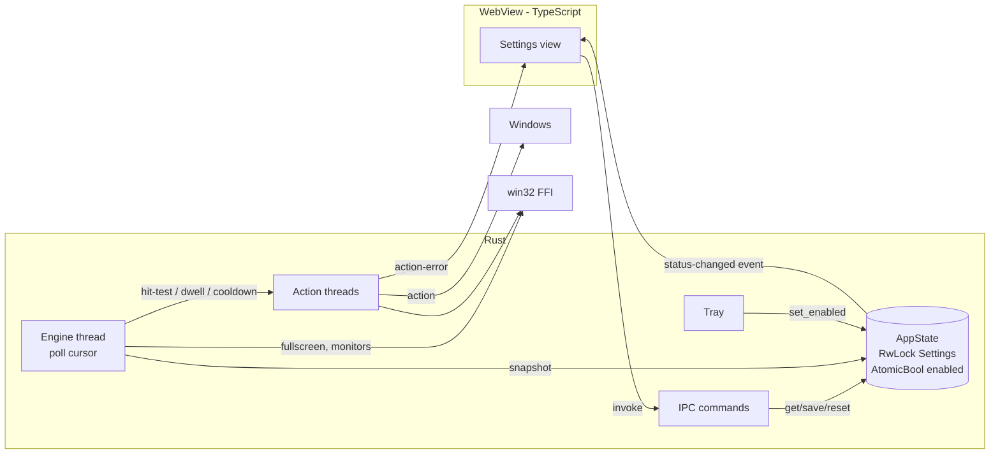

[English](architecture.md) · [Español](es/arquitectura.md)

# Architecture

## Overview

Three pieces share the process: the web UI (WebView, TypeScript), the shared state in Rust, and the engine thread that polls the cursor. The tray is not a separate module — it lives on the Tauri event loop.

Trigger flow: the engine thread reads a snapshot of the settings, asks Windows for the cursor position, hit-tests corners and edges, accumulates the zone's effective dwell and, if the cooldown has elapsed, dispatches the action on another thread. Leaving the zone re-arms it.

## Modules

| Module | Responsibility |
|---|---|
| `src-tauri/src/main.rs` | Startup, single-instance mutex, builder call |
| `src-tauri/src/lib.rs` | Tauri builder, state, IPC commands, close-to-tray handler |
| `src-tauri/src/settings.rs` | Serde model, defaults, sanitizing, atomic persistence, autostart |
| `src-tauri/src/win32.rs` | Win32 FFI: cursor, monitors, fullscreen, `SendInput`/keys, `ShellExecute` |
| `src-tauri/src/actions.rs` | Running presets, commands and URLs |
| `src-tauri/src/engine.rs` | Poll thread, hit-test, dwell/cooldown, event emission |
| `src-tauri/src/tray.rs` | Tray icon and menu |
| `src/main.ts` | The whole UI: render, state, IPC, modal sheets |
| `src/style.css` | Cream / iOS design system |
| `src/types.ts` | TypeScript contract for the settings model |

## Concurrency

| Resource | Type | Use |
|---|---|---|
| Settings | `RwLock<Settings>` | Frequent engine reads, UI writes |
| Enabled flag | `AtomicBool` | Tray and window switch without taking the lock |
| Engine thread | dedicated thread | Polls every `pollIntervalMs`; fullscreen check every 500 ms; monitor refresh every 1 s |
| Action threads | one per trigger | Presets, commands and URLs never block polling |

The engine never holds the lock while evaluating: it copies a snapshot and works on the copy. IPC commands sanitize input and return the resulting settings, which the UI adopts as-is.

## Decision: raw FFI instead of a crate

Calls into user32, kernel32 and shell32 are declared by hand with `extern "system"`. This avoids depending on the `windows`, `winapi` or `enigo` crates: fewer dependencies, a smaller binary and direct control over the signatures in use. The cost is that every declared function must be checked by hand against the Win32 documentation.

## Decisions worth knowing

- **Named events for single instance.** `main.rs` takes the `Local\CreamCornersSingleton` mutex; a second process signals `Local\CreamCornersShow` so the running instance raises its window instead of opening a second one.
- **Close means hide.** The window close handler hides the window and the process keeps polling, which is why quitting is a separate tray action.
- **Settings are the wire format.** The UI never keeps its own model: it posts the sanitized struct and adopts whatever the backend returns, which keeps the two sides in step.

## Known risks

- Polling imposes a minimum latency equal to the configured interval.
- Synthetic keys (`keybd_event`) may be ignored by elevated apps or by software that filters injected input.
- The app is not per-monitor DPI aware: zones are computed in physical pixels, which shows on setups with per-monitor scaling.
- An action can fail without stalling the engine; the failure is reported through the `action-error` event.

---

Cream Corners is created and maintained by [Canopus44](https://github.com/Canopus44).
