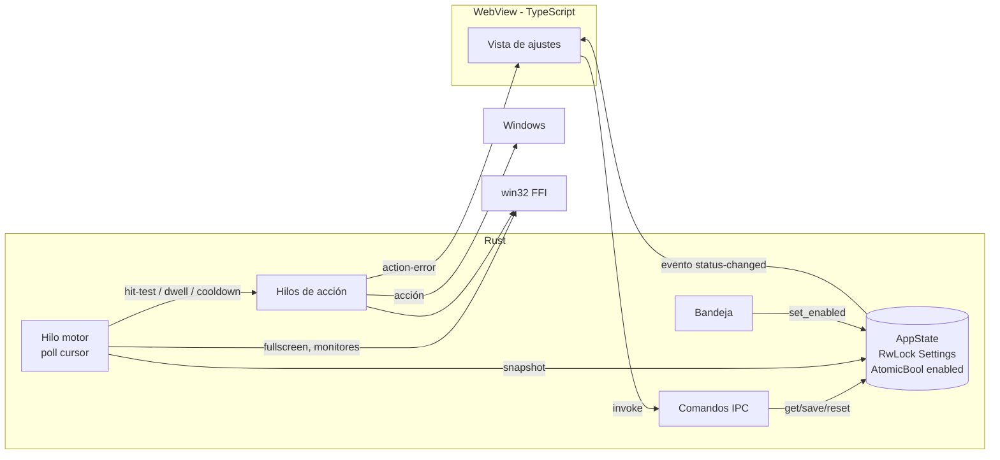

# Arquitectura

## Vista general

Tres piezas conviven en el proceso: la UI web (WebView, TypeScript), el estado compartido en Rust y el hilo del motor que sondea el cursor. La bandeja del sistema no es un módulo aparte: vive en el event loop de Tauri.

Flujo de disparo: el hilo motor lee un snapshot de la configuración, consulta la posición del cursor, hace hit-test de esquina o borde, acumula la demora efectiva de la zona y, si pasó el cooldown, despacha la acción en otro hilo. Al salir de la zona se rearma.

## Módulos

| Módulo | Responsabilidad |
|---|---|
| `src-tauri/src/main.rs` | Arranque, mutex de instancia única, llamada al builder |
| `src-tauri/src/lib.rs` | Builder de Tauri, estado, comandos IPC, cierre que oculta la ventana |
| `src-tauri/src/settings.rs` | Modelo serde, defaults, saneado, persistencia atómica, autostart |
| `src-tauri/src/win32.rs` | FFI Win32: cursor, monitores, fullscreen, `SendInput`/teclas, `ShellExecute` |
| `src-tauri/src/actions.rs` | Ejecución de presets, comandos y URLs |
| `src-tauri/src/engine.rs` | Hilo de sondeo, hit-test, dwell/cooldown, emisión de eventos |
| `src-tauri/src/tray.rs` | Icono y menú de bandeja |
| `src/main.ts` | UI completa: render, estado, IPC, hojas modales |
| `src/style.css` | Sistema de diseño crema / iOS |
| `src/types.ts` | Contrato TypeScript de la configuración |

## Concurrencia

| Recurso | Tipo | Uso |
|---|---|---|
| Configuración | `RwLock<Settings>` | Lecturas frecuentes del motor, escrituras de la UI |
| Activo/pausado | `AtomicBool` | Switch de bandeja y de ventana sin tomar el lock |
| Hilo motor | hilo propio | Sondeo cada `pollIntervalMs`; chequeo de fullscreen cada 500 ms; refresco de monitores cada 1 s |
| Hilos de acción | uno por disparo | Ejecutar presets, comandos o URLs nunca bloquea el sondeo |

El motor no retiene el lock mientras evalúa: copia el snapshot y trabaja sobre la copia. Los comandos IPC sanean la entrada y devuelven la configuración resultante, que la UI adopta tal cual.

## Decisión: FFI crudo en lugar de crate

Las llamadas a user32, kernel32 y shell32 se declaran a mano con `extern "system"`. Se evita depender de los crates `windows`, `winapi` o `enigo`: menos dependencias, binario más pequeño y control directo sobre las firmas usadas. El costo es que cada función declarada debe revisarse a mano contra la documentación de Win32.

## Riesgos conocidos

- El sondeo impone una latencia mínima igual al intervalo configurado.
- Las teclas sintéticas (`keybd_event`) pueden ser ignoradas por apps elevadas o por software que filtra entrada inyectada.
- La app no es per-monitor DPI aware: las zonas se calculan en píxeles físicos, lo que se nota en configuraciones con escalas distintas por monitor.
- Una acción puede fallar sin bloquear el motor; el error se reporta por el evento `action-error`.
