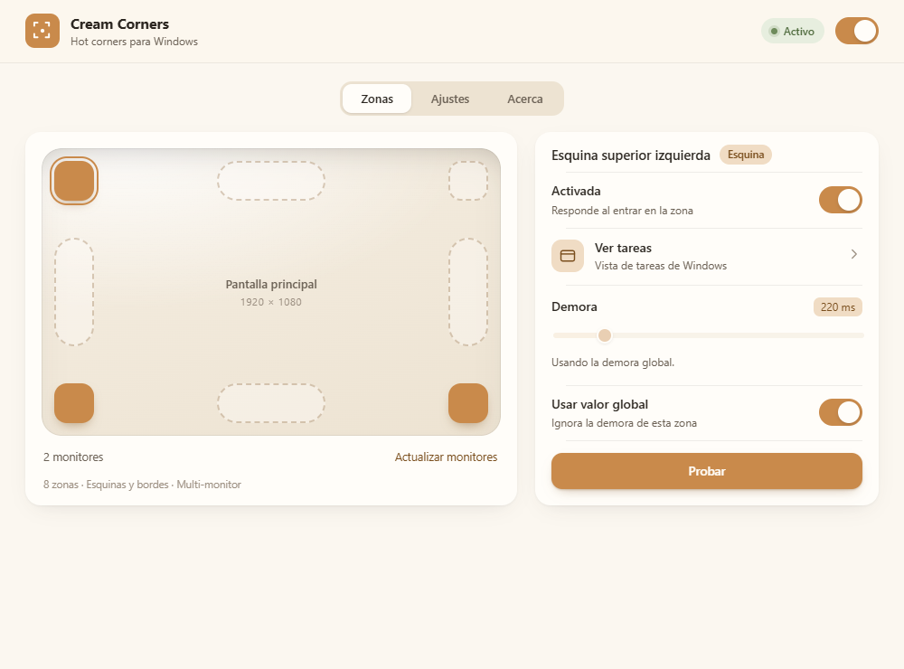

[English](../installation.md) · [Español](instalacion.md)

# Instalación

Guía para instalar Cream Corners 0.1.0 en Windows 10/11 x64 desde los instaladores publicados en GitHub. Para compilar desde el código fuente, ver [compilar.md](compilar.md).

## Requisitos

- Windows 10 u 11 de 64 bits (x64). No hay compilación para ARM64.
- WebView2 Runtime. Viene incluido en Windows 11 y en la mayoría de las instalaciones de Windows 10 actualizadas. Si falta, el instalador o la app lo indicará; se descarga desde la página oficial de Microsoft: <https://developer.microsoft.com/microsoft-edge/webview2/> (opción "Evergreen Bootstrapper" o "Evergreen Standalone Installer" x64).
- Alrededor de 10 MB de disco para el programa y unos pocos KB para la configuración.
- Permisos de administrador para instalar: ambos instaladores son per-machine y escriben en Archivos de programa.

## Descargar

1. Abre la página del release: <https://github.com/Canopus44/cream-corners/releases/latest>.
2. En la sección de archivos adjuntos del release `v0.1.0`, descarga uno de los dos instaladores:

| Archivo | Formato | Cuándo usarlo |
|---|---|---|
| `Cream Corners_0.1.0_x64-setup.exe` | NSIS | Recomendado para uso normal |
| `Cream Corners_0.1.0_x64_en-US.msi` | WiX / Windows Installer | Despliegue administrado (GPO, Intune, SCCM) |

3. Opcionalmente descarga el archivo de sumas SHA-256 publicado en el release, para verificar la descarga (ver [Verificación de integridad](#verificación-de-integridad)).

## Instalar

### Opción recomendada: NSIS (`Cream Corners_0.1.0_x64-setup.exe`)

1. Ejecuta el archivo con doble clic.
2. Si aparece SmartScreen, ver [SmartScreen](#smartscreen).
3. Windows pedirá elevación por UAC: el instalador es per-machine e instala para todos los usuarios en Archivos de programa (`C:\Program Files\Cream Corners`).
4. La interfaz del instalador está disponible en inglés y español y toma el idioma del sistema; sigue el asistente y espera a que termine.
5. Deja marcada la opción de abrir la app si aparece.

El instalador NSIS agrega la entrada en el menú Inicio y registra la app en "Aplicaciones instaladas" para poder desinstalarla después.

### Alternativa: MSI (`Cream Corners_0.1.0_x64_en-US.msi`)

1. Ejecuta el archivo con doble clic. Windows pedirá permisos de administrador, porque el MSI también instala para todos los usuarios en `C:\Program Files\Cream Corners`.
2. Sigue el asistente de Windows Installer hasta el final.

El MSI es la opción adecuada si vas a distribuir la app con herramientas de administración (GPO, Intune, SCCM). Para una instalación silenciosa:

```powershell
msiexec /i "Cream Corners_0.1.0_x64_en-US.msi" /qn
```

Ambos instaladores contienen el mismo programa; no hace falta instalar los dos.

## Primer uso

Al terminar la instalación, Cream Corners arranca y queda en la bandeja del sistema, junto al reloj. No muestra ventana al iniciar si ya tenía configuración guardada.

- **Abrir la ventana**: clic izquierdo en el icono de la bandeja, doble clic, o clic derecho y **Cambiar comandos**.
- **Cerrar la ventana**: la oculta en la bandeja. El proceso sigue activo y las zonas siguen funcionando.
- **Salir del todo**: clic derecho en el icono de la bandeja y **Salir**.

Configuración de fábrica de las zonas:

| Zona | Acción |
|---|---|
| Esquina superior izquierda | Ver tareas (Task View) |
| Esquina inferior izquierda | Mostrar escritorio |
| Esquina inferior derecha | Bloquear equipo |
| Resto de esquinas y bordes | Sin acción |



Para probar que funciona en tu equipo, deja el cursor quieto en la esquina superior izquierda: debe abrirse la vista de tareas de Windows. Si no ocurre, ver [Problemas frecuentes](#problemas-frecuentes).

Cada zona se configura en la ventana: activación, acción, demora propia y tamaño. Los ajustes se guardan solos, sin botón de guardar.

## SmartScreen

Los instaladores no están firmados con un certificado de código, así que Windows puede mostrar la pantalla azul "Windows protegió tu PC" con el editor "Editor desconocido".

Para continuar:

1. Pulsa **Más información**.
2. Pulsa **Ejecutar de todas formas**.

Es el comportamiento normal de Windows con programas sin firma; no indica que el archivo esté modificado. Si prefieres comprobarlo antes, verifica la suma SHA-256 contra la publicada en el release.

## Dónde se guarda la configuración

Cream Corners guarda todo en `%APPDATA%\CreamCorners\`:

| Archivo | Contenido |
|---|---|
| `settings.json` | Configuración activa |
| `settings.bak.json` | Copia de la última versión válida |
| `settings.corrupt-<epoch>.json` | Cuarentena de un archivo que no se pudo leer |

Si `%APPDATA%` no está disponible, se usa `%LOCALAPPDATA%\CreamCorners\`. Para abrir la carpeta, usa "Abrir carpeta de configuración" en la ventana de la app.

El formato y el significado de cada campo están en [configuracion.md](configuracion.md).

La desinstalación **no** borra esta carpeta: al reinstalar se recuperan los ajustes anteriores. Si quieres empezar de cero, cierra la app, borra la carpeta completa y vuelve a abrirla:

```powershell
Remove-Item -Recurse "$env:APPDATA\CreamCorners"
```

## Iniciar con Windows

La app puede arrancar sola al iniciar sesión. El interruptor **Iniciar con Windows** de la ventana crea o elimina el valor `CreamCorners` en:

```
HKCU\Software\Microsoft\Windows\CurrentVersion\Run
```

Es una entrada por usuario, sin permisos de administrador. Si mueves el ejecutable de carpeta, desactiva y vuelve a activar el interruptor para que la ruta registrada se actualice.

## Desinstalar

1. Abre **Configuración → Aplicaciones → Aplicaciones instaladas** (Windows 11) o **Configuración → Aplicaciones y características** / **Panel de control → Programas y características** (Windows 10).
2. Busca **Cream Corners**, abre el menú y elige **Desinstalar**.
3. Confirma.

Si prefieres la línea de comandos para el paquete MSI:

```powershell
msiexec /x "Cream Corners_0.1.0_x64_en-US.msi" /qn
```

Qué se conserva y qué se borra:

- Se eliminan el programa, los accesos directos y la entrada de desinstalación.
- La configuración en `%APPDATA%\CreamCorners\` se conserva; bórrala a mano si no la quieres.
- El valor `CreamCorners` de `HKCU\...\CurrentVersion\Run` se conserva si estaba activo. Si reinstalas y no quieres el arranque automático, revisa el interruptor y, si hace falta, elimina el valor:

```powershell
Remove-ItemProperty "HKCU:\Software\Microsoft\Windows\CurrentVersion\Run" -Name CreamCorners -ErrorAction SilentlyContinue
```

Si el icono de la bandeja queda visible después de desinstalar, es un resto del Explorador: reinícialo desde el Administrador de tareas (clic derecho en **Explorador de Windows** → **Reiniciar**) o cierra sesión y vuelve a entrar.

## Problemas frecuentes

### El icono no aparece en la bandeja

Windows oculta los iconos nuevos por defecto.

- Windows 11: **Configuración → Personalización → Barra de tareas → Otros iconos de la bandeja del sistema** y activa **Cream Corners**.
- Windows 10: **Configuración → Personalización → Barra de tareas → Seleccionar los iconos que aparecen en la barra de tareas** y activa **Cream Corners**.

Si tampoco aparece en esa lista, la app no está en ejecución: ábrela desde el menú Inicio.

### La app está abierta pero no reacciona a las esquinas

En orden:

1. Verifica que el check **Activo** de la bandeja y el interruptor de la ventana estén encendidos.
2. Cierra o minimiza la aplicación en pantalla completa: con la pausa por fullscreen activa, la detección se detiene.
3. Confirma que la zona tenga una acción asignada y esté activada.
4. Baja la demora de activación (prueba 100 ms) y acerca más el cursor a la esquina; el área efectiva depende del tamaño configurado.
5. Revisa que otra herramienta (gestos del trackpad, docks, apps de captura) no esté usando la misma zona.

Más casos en [solucion-de-problemas.md](solucion-de-problemas.md).

### Al abrir el ejecutable no pasa nada o aparece una segunda ventana

La app es de instancia única: si ya está corriendo, el nuevo lanzamiento cierra su propio proceso y trae al frente la ventana existente mediante el evento con nombre `Local\CreamCornersShow`. Si no ves la ventana:

1. Busca el icono en la bandeja y elige **Cambiar comandos**.
2. Si no responde, ciérrala desde el Administrador de tareas (**Cream Corners**) y vuelve a abrirla.

### "Acceso denegado" al iniciar el ejecutable desde una carpeta de usuario

Si ejecutas la app desde una carpeta bajo Documentos o Escritorio, algunas políticas locales o el antivirus corporativo pueden impedir la escritura de `settings.json` en `%APPDATA%`. El síntoma es un error de acceso denegado al guardar la configuración. Instálala con el instalador en su carpeta normal y el problema desaparece.

### Las acciones de teclado no llegan a una aplicación

La app envía teclas con `keybd_event`; las ventanas elevadas pueden descartar esa entrada sintética por UIPI. Usa un preset que no dependa de teclas (por ejemplo, abrir el explorador o la configuración de Windows) o ejecuta Cream Corners como administrador.

### Falta WebView2

Si la ventana queda en blanco o la app no arranca, instala el WebView2 Runtime desde <https://developer.microsoft.com/microsoft-edge/webview2/> y vuelve a abrir Cream Corners.

## Verificación de integridad

Los hashes SHA-256 de ambos instaladores se publican en las notas del release `v0.1.0`, junto a los archivos adjuntos. Para comprobar una descarga:

```powershell
Get-FileHash ".\Cream Corners_0.1.0_x64-setup.exe" -Algorithm SHA256
```

Compara el valor obtenido con el del release. Si no coincide, vuelve a descargar el archivo antes de ejecutarlo.
